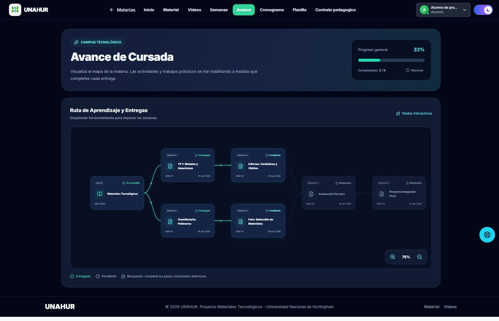

# Avance de cursada

La pestaña **Avance** abre `/materia/:id/avance`. El recorrido usa las actividades de las semanas de la cursada y, para alumnos, únicamente las semanas publicadas de su comisión. Si hay varias cursadas aprobadas, se puede elegir una.

Cada semana con actividades ocupa una columna. Cuando dos columnas tienen igual cantidad de actividades, sus ramas se conectan por orden de creación. Cuando la cantidad cambia, cada actividad siguiente requiere completar todas las de la columna anterior. Las semanas sin actividades se omiten del mapa.

Las tarjetas muestran descripción, fecha límite, recurso y acceso a la semana. El mapa tiene zoom entre 50% y 150%, desplazamiento horizontal, arrastre con mouse y conexiones animadas; las animaciones se desactivan con la preferencia de movimiento reducido.

**Marcar como entregado** guarda avance personal por alumno, cursada y ejercicio. La entrega del trabajo sigue realizándose por el medio indicado por la cátedra. Las notas de la planilla de seguimiento son independientes. **Reiniciar** pide confirmación y elimina únicamente las marcas personales de esa cursada.

Docentes y administradores pueden simular el recorrido con los contenidos de su materia. La simulación vive en la pantalla y no escribe entregas en la base. La vista de alumno seleccionada desde el proyecto respeta la cursada y comisión elegidas.

## Base de datos y API

La migración `1779548265162-AddAvanceEjercicio` crea `avance_ejercicio`, con claves foráneas e índice único sobre alumno, cursada y ejercicio. Los comandos `npm run start:local`, `npm run start:dev`, `npm run start:debug` y `npm run start:prod` ejecutan las migraciones pendientes antes de iniciar el servidor. Si el servidor ya estaba iniciado antes de actualizar el código, ejecutar `npm run migration:run` desde `backend` o reiniciarlo con uno de esos comandos. La tabla es necesaria tanto para consultar como para guardar el avance de alumnos.

- `GET /avance/cursada/:cursadaId`: recorrido propio o simulación autorizada. Un alumno siempre usa su comisión; el parámetro `comisionId` sólo selecciona la comisión para la simulación docente.
- `PUT /avance/cursada/:cursadaId/ejercicio/:ejercicioId`: registra avance propio, valida requisitos y conserva la fecha inicial ante reintentos.
- `DELETE /avance/cursada/:cursadaId/completadas`: reinicia avance propio sin alterar notas ni entregas de otros alumnos.

La pestaña y su encabezado se pueden configurar desde **Configuración** de la materia.

## Verificación

Se verificaron 87 pruebas de frontend y 146 de backend. Las pruebas de integración usaron una base PostgreSQL 15 temporal, incluyendo aislamiento entre alumnos y comisiones, persistencia, reintentos, semanas futuras y conservación de notas. Las 30 migraciones existentes y nuevas se aplicaron; la nueva también se revirtió y volvió a aplicar correctamente.

Ambos builds, TypeScript, ESLint sobre los archivos modificados y formato pasaron. La interfaz se probó en el navegador integrado en escritorio, notebook, tablet y móvil. La vista local de demostración usa datos aislados de ejemplo; las capturas no corresponden a alumnos reales.

